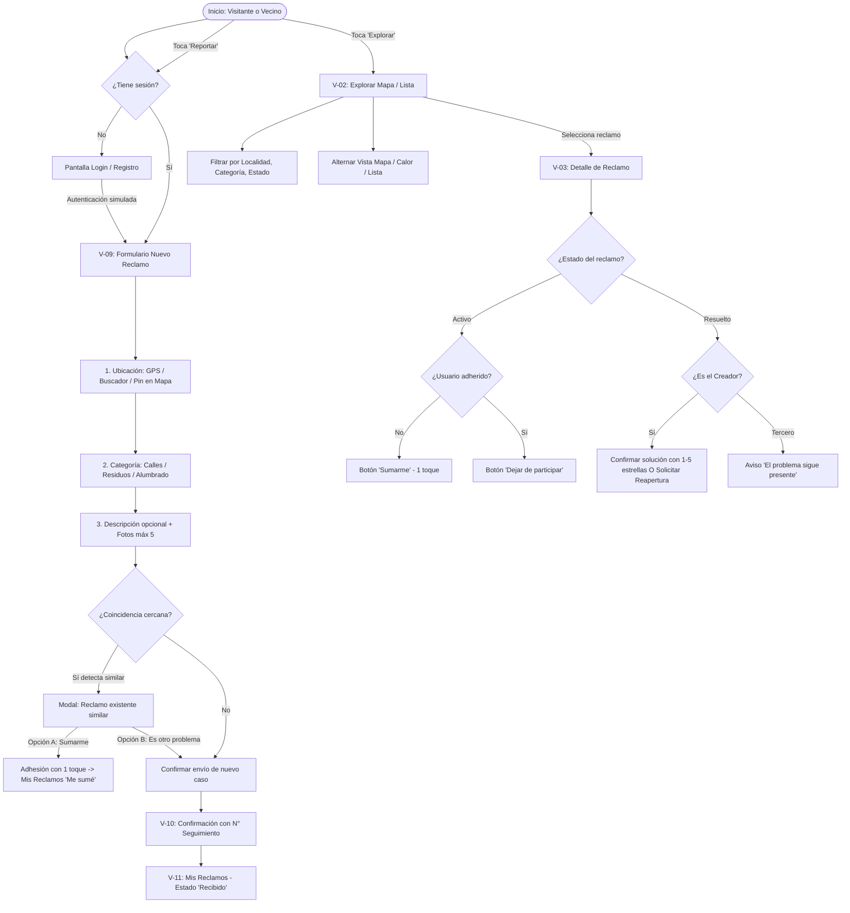
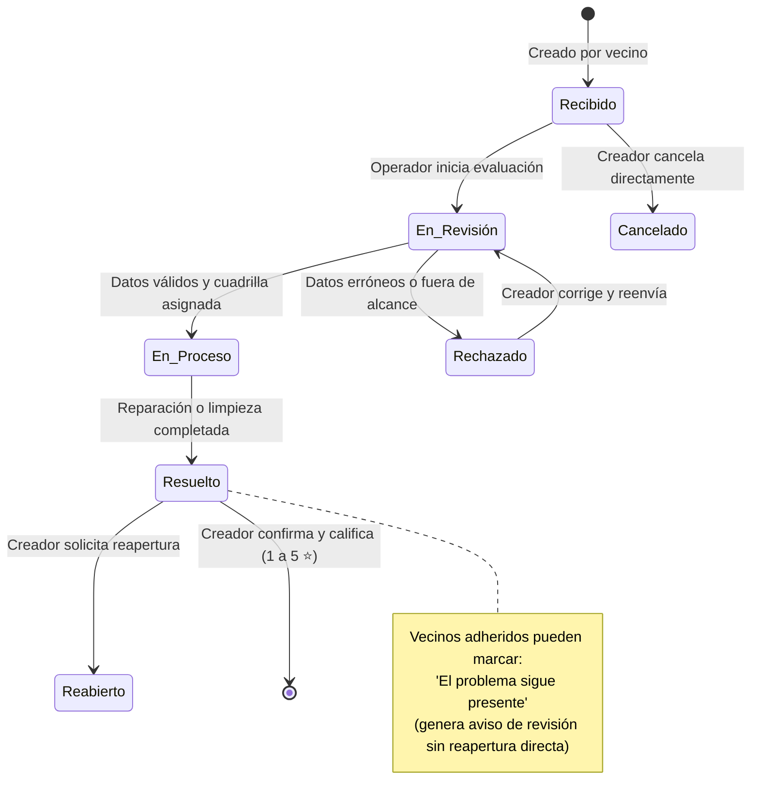

# Diagnóstico y Plan de Preparación Integral: SoluciónSegura
**Plataforma Conceptual de Reclamos Urbanos — La Matanza**  
*Cátedra: Visualización e Interfaces — Universidad Nacional de La Matanza (UNLaM)*

---

## 1. Comprensión de la Finalidad Académica y Alcance Técnico

### 1.1 Naturaleza del Proyecto
**SoluciónSegura** es una **maqueta académica funcional y responsive**, diseñada como trabajo práctico final de la materia *Visualización e Interfaces* en la Universidad Nacional de La Matanza (UNLaM).

* **Propósito evaluativo:** Demostrar la aplicación rigurosa de marcos teóricos de interacción persona-ordenador (HCI), arquitectura de información, heurísticas de usabilidad, diseño visual orientado a la inclusión ciudadana y accesibilidad web.
* **Propósito cívico/conceptual:** Proponer una interfaz ciudadana accesible, transparente y comunitaria para informar incidencias en el espacio público de La Matanza, priorizando la sencillez frente a la complejidad burocrática.
* **Declaración de prototipo:** La plataforma no es un sistema municipal en producción ni un canal gubernamental oficial. Se identificará discretamente como maqueta académica cuando corresponda para mantener la honestidad conceptual del prototipo.

### 1.2 Límites Técnicos y Simulación
* **Stack tecnológico base:** Frontend web nativo, estándar y liviano: **HTML5 semántico, CSS3 modular (con tokens y variables) y JavaScript moderno (ES Modules)**.
* **Sin backend ni base de datos real:** No se implementarán servidores propios, bases de datos remotas ni pasarelas con APIs oficiales.
* **Persistencia y reactividad local:** Se utilizará `localStorage` como motor de persistencia del estado en el navegador: sesión simulada, reclamos ficticios iniciales, reclamos creados por el usuario, adhesiones comunitarias, borradores automáticos y notificaciones.
* **Cartografía interactiva:** Integración cartográfica ligera mediante **Leaflet.js + OpenStreetMap**, compatible con geolocalización simulada o real del navegador, marcadores personalizados por categoría, clustering de puntos cercanos y alternancia a mapa de calor (*heat map*).
* **Autenticación simulada:**
  * Opción "Continuar con Google" mediante diálogo modal de confirmación ficticia.
  * Registro mínimo por correo y contraseña (nombre, email y contraseña).
  * **Regla estricta:** Queda terminantemente eliminado todo requerimiento de número de padrón municipal, DNI, número de partida catastral o verificación domiciliaria.

---

## 2. Inventario de Pantallas y Funcionalidades a Representar

La arquitectura se organiza en **13 vistas principales** conectadas mediante un enrutador ligero de vistas, complementadas por diálogos modales, hojas inferiores (*bottom sheets*) y toasts:

| # | Código | Vista | Acceso | Responsabilidad y Componentes Clave |
|---|---|---|---|---|
| 1 | **V-01** | **Inicio (Home)** | Público | Hero identitario con azul profundo (`#062F66`), botón primario *"Realizar reclamo"*, botón secundario *"Explorar reclamos"*, acceso a las 3 categorías, indicadores métricos generales, bloque *"Cómo funciona"* en 3 pasos explicativos y acceso a *"Mis reclamos"* para usuarios con sesión. |
| 2 | **V-02** | **Explorar Reclamos** | Público | Selector de vista **Mapa ↔ Lista**. Filtros sincronizados por Categoría, Localidad y Estado. Agrupamiento de marcadores (clustering), selector de Mapa de Calor (*heat map*), tarjetas con estado y contador de apoyos. |
| 3 | **V-03** | **Detalle de Reclamo** | Público | Encabezado con estado e identificador (#LM-XXXXX), mapa con pin exacto, galería fotográfica (1 a 5 imágenes), contador de participantes, línea de progreso cronológica (Recibido → Resuelto) y botón de adhesión *"Sumarme"* o aviso *"El problema sigue presente"*. Privacidad absoluta del creador (sin datos personales expuestos). |
| 4 | **V-04** | **Estadísticas Públicas** | Público | Indicadores clave (Totales, Activos, Resueltos, % Resolución), gráficos por categoría, localidad y estado, evolución temporal y filtro interactivo por localidad. |
| 5 | **V-05** | **Ayuda y Contacto** | Público | Guía de uso en 3 pasos, preguntas frecuentes (acordeón accesible), canales de soporte conceptual y formulario de consulta simulado con mensaje de confirmación. |
| 6 | **V-06** | **Iniciar Sesión** | Público | Formulario de email y contraseña ficticios, acceso simulado *"Continuar con Google"*, recuperación de contraseña y enlace a registro. Retención de ruta destino previa (`redirectBackUrl`). |
| 7 | **V-07** | **Registrarse** | Público | Formulario mínimo: Nombre, Correo electrónico y Contraseña. Validación contextual en blur. |
| 8 | **V-08** | **Recuperar Contraseña** | Público | Solicitud de email con mensaje de envío ficticio y retorno a login. |
| 9 | **V-09** | **Nuevo Reclamo** | Registrado | **Formulario en vista única continua:**<br>1) Ubicación: búsqueda de calle, GPS o ajuste manual del pin en mapa.<br>2) Categoría: selector táctil entre Calles, Residuos y Alumbrado.<br>3) Descripción opcional.<br>4) Hasta 5 fotos opcionales con previsualización y eliminación.<br>5) Guardado automático de borrador en `localStorage`. |
| 10 | **V-10** | **Confirmación de Envío** | Registrado | Pantalla de éxito inequívoca: «Tu reclamo fue registrado», identificador asignado (#LM-XXXXX), estado inicial *"Recibido"*, accesos directos a *"Ver mis reclamos"* y *"Volver al inicio"*. |
| 11 | **V-11** | **Mis Reclamos** | Registrado | Panel privado con 3 pestañas: *Todos*, *Creados por mí* y *Me sumé*. Indicador de rol, acciones de edición o cancelación según estado y estados vacíos (*empty states*) propositivos. |
| 12 | **V-12** | **Mi Perfil** | Registrado | Nombre, email, localidad preferida (centra el mapa en Explorar), configuración de notificaciones simuladas (app y correo) y botón de cierre de sesión. |
| 13 | **V-13** | **Notificaciones** | Registrado | Bandeja de avisos del sistema (campana): cambios de estado, confirmaciones de adhesión, avisos de resolución/reapertura y simulación de correo electrónico. |

---

## 3. Recorridos Principales y Alternativos del Usuario (User Flows)



### Escenarios Alternativos y Excepciones:
1. **Pérdida de conectividad o recarga:** El borrador se guarda en `localStorage`. Si el usuario recarga la página o se corta la conexión, la interfaz muestra un aviso no intrusivo y restaura automáticamente los campos completados.
2. **Detección de reclamo similar:** Antes de crear una nueva incidencia, el sistema revisa reclamos en un radio cercano con la misma categoría. Muestra la tarjeta del reclamo existente y permite sumarse con un toque o indicar *"Es otro problema"* para continuar con el nuevo reporte.
3. **Ubicación imprecisa o fuera del municipio:** Si la búsqueda no arroja resultados o el GPS es denegado, se ofrece colocar y ajustar el marcador manualmente sobre el mapa de La Matanza.
4. **Retiro de apoyo:** Un vecino que se sumó puede retirarse desde el Detalle o desde *"Mis reclamos"*. Se resta el contador, se actualiza la vista y se muestra un toast con opción de deshacer.

---

## 4. Identificación de Reglas, Estados, Permisos y Validaciones

### 4.1 Máquina de Estados del Reclamo



### 4.2 Matriz de Derechos y Permisos por Estado

| Estado | Acciones del Creador | Acciones de Vecinos Adheridos | Acciones de Visitantes |
|---|---|---|---|
| **Recibido** | Editar calle, categoría y descripción / Cancelar directamente | Sumarse / Retirar apoyo | Ver detalle público / Solicita login para sumarse |
| **En revisión** | Solicitar corrección (bloqueada la edición directa) | Sumarse / Retirar apoyo | Ver detalle público |
| **En proceso** | Consultar avances / Solicitar corrección | Sumarse / Retirar apoyo | Ver detalle público |
| **Resuelto** | Confirmar solución (calificación 1 a 5 ⭐) O Solicitar reapertura | Marcar *"El problema sigue presente"* | Ver detalle público |
| **Rechazado** | Ver causa / Corregir y reenviar para nueva revisión | Notificación del motivo | Ver detalle público |
| **Reabierto** | Seguir evolución del caso reexaminado | Sumarse / Seguir caso | Ver detalle público |
| **Cancelado** | Consulta de archivo (permanece en historial) | Notificación de cancelación | Ver caso cancelado en historial |

---

## 5. Skills Encontradas, Revisadas y Aplicadas

Durante la etapa de inspección se verificaron y estudiaron las siguientes directivas especializadas del entorno:

1. **`antislop-ui`** (`C:\Users\Facundo-PC\.gemini\config\plugins\anti-slop\skills\antislop-ui\SKILL.md`)
   * **Criterios aplicados:**
     * Prohibición de degradados genéricos azul-púrpura y orbes borrosos de fondo. La paleta proviene de la identidad del proyecto (`#062F66`, `#078DFA`, `#EFF6FF`).
     * Dosis controlada de sombras y elevaciones: tarjetas de superficie mate; sombras restringidas a modales y hojas flotantes.
     * Prohibición absoluta de emojis decorativos en títulos y botones (`🚀`, `🔥`, `✅`). Los iconos son funcionales y con propósito semántico.
     * Sin etiquetas vacías de "AI Powered" ni pulsos infinitos decorativos.
     * Gráficos estadísticos con preguntas claras para la toma de decisiones, sin métricas inventadas de adorno.

2. **`emil-design-eng`** (`j:\PROYECTOS\SolucionSegura\.agents\skills\emil-design-eng\SKILL.md`)
   * **Criterios aplicados:**
     * Respuesta física inmediata al presionar: `transform: scale(0.97)` en `:active` para botones y tarjetas.
     * Curva de aceleración natural: `cubic-bezier(0.23, 1, 0.32, 1)` para transiciones de modales y drawers.
     * Nunca animar desde `scale(0)`: usar `scale(0.95)` combinado con `opacity: 0` para una entrada natural.
     * Tiempos de animación ágiles (<250ms en interacción de interfaz; 160ms en feedback táctil).
     * Modales con origen en el centro; popovers y menús anclados a su disparador (`transform-origin`).
     * Asimetría de tiempos: presión sostenida si requiere reflexión; respuesta y cierre instantáneos.

3. **`mobile-design`** (`j:\PROYECTOS\SolucionSegura\.agents\skills\mobile-design\SKILL.md`)
   * **Criterios aplicados:**
     * **Zona del pulgar (Thumb Zone):** Controles primarios y barra de navegación situados en la parte inferior de la pantalla para uso con una sola mano en la vía pública.
     * **Dimensiones táctiles:** Áreas interactivas con un mínimo de **44x44px** (óptimo 48px).
     * Formularios optimizados para la calle: atributos `inputmode`, selectores táctiles grandes y autoguardado de borrador ante fallas de señal móvil.

4. **`ui-a11y`** (`j:\PROYECTOS\SolucionSegura\.agents\skills\ui-a11y\SKILL.md`)
   * **Criterios aplicados:**
     * Contraste tipográfico superior a **4.5:1** en texto general y **3:1** en controles e iconos de estado.
     * Los estados nunca se expresan solo mediante color: van acompañados de un icono vectorial y una etiqueta textual explícita.
     * Foco de teclado claramente visible (`focus-visible: 2px solid var(--color-accent)`).
     * Soporte para `@media (prefers-reduced-motion: reduce)` suprimiendo transiciones bruscas.

5. **`ux-audit` & `ui-review`** (`j:\PROYECTOS\SolucionSegura\.agents\skills\ux-audit\SKILL.md` y `ui-review\SKILL.md`)
   * **Criterios aplicados:**
     * Auditoría sistemática bajo las 10 heurísticas de Nielsen.
     * Ausencia de callejones sin salida: cada estado vacío guía al usuario hacia una acción concreta (*"Realizar reclamo"* o *"Explorar reclamos"*).
     * Confirmación explícita para acciones críticas y opciones de deshacer (*undo*).

---

## 6. Evaluación de Principios Académicos de UX/UI y Accesibilidad

| Autor / Marco | Principio Clave | Aplicación Concreta en SoluciónSegura |
|---|---|---|
| **Jakob Nielsen** | *Visibilidad del estado del sistema* | Línea de progreso de 4 etapas con marcas cronológicas; badges semánticos con texto e icono; toasts de retroalimentación inmediata. |
| | *Correspondencia con el mundo real* | Categorías barriales claras (*"Calles y pavimento"*, *"Basura y residuos"*, *"Alumbrado público"*); fechas relativas cotidianas (*"Hace 3 horas"*, *"Ayer"*). |
| | *Libertad y control del usuario* | Deshacer adhesión con un toque; cancelar reclamo en estado Recibido; diálogos de confirmación antes de acciones irreversibles. |
| | *Prevención y recuperación de errores* | Detección preventiva de reclamos similares antes del envío; validación en `blur` con sugerencias de corrección; autoguardado continuo de borradores. |
| **Donald Norman** | *Nivel Visceral* | Hero sobrio en azul `#062F66`; tipografía nítida y geométrica; micro-interacciones suaves que transmiten orden institucional sin frialdad burocrática. |
| | *Nivel Conductual (Affordances & Signifiers)* | Botones con feedback táctil físico (`scale(0.97)`); inputs con bordes delimitados; marcadores de mapa con iconos inequívocos por temática. |
| | *Nivel Reflexivo* | Al observar cómo otros vecinos se suman a su reclamo o ver el caso resuelto con calificación comunitaria, el vecino experimenta eficacia colectiva real. |
| **Daniel Mordecki** | *Mirar, Leer y Pensar* | **Mirar:** Jerarquía visual estricta (un solo botón principal visible por pantalla).<br>**Leer:** Microcopy directo, sin terminología técnica ni legal.<br>**Pensar:** Reducción del esfuerzo cognitivo mediante selectores visuales en lugar de campos de texto obligatorios. |
| **Carlos Scolari** | *Metáforas de Interfaz* | El *marcador cartográfico* como punto de anclaje geográfico; la *línea de tiempo* como biografía del reclamo; la *campana* como buzón de novedades; la *adhesión* como respaldo comunitario. |
| **Ben Shneiderman** | *Las 8 Reglas de Oro* | Consistencia en nomenclatura de estados en toda la web; cierre categórico tras enviar reporte (*"Tu reclamo fue registrado"*); reducción de carga de memoria mostrando resúmenes de datos. |
| **Accesibilidad (WCAG 2.2 AA)** | *Perceptible, Operable, Comprensible, Robusto* | Contraste certificado > 4.5:1; textos redimensionables sin desbordes; navegación íntegra por Tabulador; atributos `aria-live` para anunciar actualizaciones; áreas táctiles $\ge 44\times 44\text{ px}$. |

---

## 7. Arquitectura de Archivos (Vanilla Web Standards)

Estructura modular orientada a un prototipo limpio, mantenible y sin sobrecarga de frameworks:

```
SolucionSegura/
├── index.html                   # Shell responsive de la aplicación (SPA ligera)
├── assets/
│   ├── icons/                   # SVGs limpios de categorías, navegación y estados
│   ├── images/                  # Fotos de prueba para baches, residuos y luminarias
│   └── brand/                   # Logo vectorial blanco de SoluciónSegura
├── css/
│   ├── 01-tokens.css            # Paleta (#062F66, #078DFA, etc.), tipografía, radios y sombras
│   ├── 02-reset.css             # Normalización, box-sizing, accesibilidad (prefers-reduced-motion)
│   ├── 03-layout.css            # Desktop container (max-width controlado), shell móvil inmersivo
│   ├── 04-components/
│   │   ├── buttons.css          # Botones primarios, secundarios, estados :active
│   │   ├── cards.css            # Tarjetas de reclamos, categorías e indicadores
│   │   ├── forms.css            # Inputs táctiles, dropzone de imágenes, selectores
│   │   ├── navigation.css       # Barra inferior fija móvil y cabecera desktop
│   │   ├── modals.css           # Diálogos emergentes, bottom-sheets táctiles y toasts
│   │   ├── status-timeline.css  # Línea de progreso interactiva (Recibido → Resuelto)
│   │   └── map.css              # Contenedor Leaflet, pines temáticos, clusters y leyenda
│   └── 05-utilities.css         # Clases utilitarias de espaciado y accesibilidad
├── js/
│   ├── app.js                   # Punto de entrada, router de vistas y orquestación
│   ├── data/
│   │   ├── seed-reclamos.js     # Conjunto inicial de reclamos representativos de La Matanza
│   │   ├── store.js             # Gestor reactivo de localStorage (reclamos, usuarios, borradores)
│   │   └── localities.js        # Localidades del partido (San Justo, Ramos Mejía, etc.)
│   ├── components/
│   │   ├── navbar.js            # Control de navegación activa móvil y desktop
│   │   ├── toast.js             # Notificaciones no intrusivas con soporte de deshacer
│   │   ├── modal.js             # Gestor de diálogos y hojas flotantes accesibles
│   │   └── timeline.js          # Línea cronológica de estados
│   ├── modules/
│   │   ├── auth.js              # Lógica de login/registro simulado y sesión persistente
│   │   ├── map-service.js       # Integración Leaflet, marcadores por categoría, heat map
│   │   ├── claims-service.js    # Creación, adhesión, retiro de apoyo, filtrado y coincidencias
│   │   ├── stats-service.js     # Cálculo de métricas y gráficos SVG
│   │   └── draft-service.js     # Guardado automático de borrador en segundo plano
└── documentos/
    ├── Documentacion_funcional_Reclamos_La_Matanza_.md
    └── Diagnostico_y_Plan_Preparacion_SolucionSegura.md
```

---

## 8. Estrategia de Datos Ficticios y Persistencia Local (`localStorage`)

### 8.1 Esquema de Datos Central (`store.js`)
```javascript
{
  "currentUser": {
    "id": "usr_vecino_01",
    "nombre": "Mariana Gómez",
    "email": "mariana.gomez@ejemplo.com",
    "localidadPreferida": "San Justo",
    "notificaciones": { "app": true, "email": true }
  },
  "reclamos": [
    {
      "id": "LM-48291",
      "titulo": "Bache profundo en intersección peligrosa",
      "categoria": "pavimento", // 'pavimento' | 'residuos' | 'alumbrado'
      "descripcion": "Cráter de gran tamaño frente a la parada de colectivos.",
      "direccion": "Almafuerte 3100, San Justo",
      "lat": -34.6791,
      "lng": -58.5574,
      "creadorId": "usr_vecino_02", // Privado, no visible en UI pública
      "fecha": "2026-11-08T10:30:00Z",
      "estado": "en_proceso", // 'recibido' | 'en_revision' | 'en_proceso' | 'resuelto' | 'rechazado' | 'reabierto' | 'cancelado'
      "prioridad": "alta", // 'baja' | 'media' | 'alta' (combinación de apoyos y gravedad)
      "fotos": ["assets/images/bache-ejemplo.webp"],
      "participantes": ["usr_vecino_02", "usr_vecino_03", "usr_vecino_01"], // Cantidad = 3
      "historial": [
        { "fecha": "2026-11-08T10:30:00Z", "estado": "recibido", "nota": "Reclamo registrado por el vecino." },
        { "fecha": "2026-11-09T08:15:00Z", "estado": "en_revision", "nota": "Verificación técnica de ubicación aprobada." },
        { "fecha": "2026-11-10T11:00:00Z", "estado": "en_proceso", "nota": "Cuadrilla asignada para bacheo en frío." }
      ]
    }
  ],
  "borrador": {
    "direccion": "",
    "lat": null,
    "lng": null,
    "categoria": "",
    "descripcion": "",
    "fotosTemp": []
  },
  "notificaciones": [
    {
      "id": "notif_01",
      "reclamoId": "LM-48291",
      "titulo": "Actualización de tu reclamo",
      "mensaje": "El reclamo LM-48291 pasó al estado 'En proceso'.",
      "leido": false,
      "fecha": "2026-11-10T11:00:00Z"
    }
  ]
}
```

### 8.2 Principios del Almacén
1. **Carga inicial automática:** Si `localStorage` está vacío, se precarga la colección de `seed-reclamos.js` distribuidos en diversas localidades (San Justo, Ramos Mejía, Isidro Casanova, González Catán, etc.).
2. **Sincronización inmediata:** Cualquier nuevo reclamo, adhesión de apoyo (`+1`), retiro (`-1`) o cambio de estado actualiza `localStorage` de manera síncrona.
3. **Botón de restauración:** Se incluirá un enlace discreto de *"Restablecer datos de prueba"* para que el evaluador docente pueda reiniciar la demostración al estado original con un solo clic.

---

## 9. Recomendaciones para el Sistema de Diseño (Design System)

### 9.1 Reglas Globales de Layout (Regla de Usuario)
* **Desktop:**
  * **La aplicación nunca ocupará el 100% del ancho en monitores de escritorio.**
  * Contenedor centrado con `max-width: 1180px` y `margin: 0 auto`.
  * Padding generoso (`padding: 2rem` a `3rem`) y separación visual descansada.
  * Se evitan componentes pegados a los bordes, barras estiradas o vacíos gigantescos.
* **Mobile (Mobile-First):**
  * Vista fullscreen inmersiva adaptada a la anatomía de la mano.
  * Barra inferior fija con 3 accesos principales: **Inicio, Explorar, Reportar**.
  * Encabezado superior compacto con campana de notificaciones y avatar de perfil.

### 9.2 Paleta de Colores y Tokens Semánticos
* **Azul institucional oscuro (`#062F66`):** Identidad del hero, cabeceras y elementos de marca.
* **Azul de acento (`#078DFA`):** Botones de acción principal, focos interactivos y enlaces.
* **Azul claro de superficie (`#EFF6FF`):** Fondos suaves para tarjetas informativas y badges.
* **Fondo neutro (`#F8FAFC`):** Fondo de lectura limpio y descansado.
* **Blanco puro (`#FFFFFF`):** Superficies de tarjetas, modales y formularios.

---

## 10. Plan de Implementación por Etapas

1. **Etapa 1: Arquitectura y Tokens de Diseño**
   * Configuración de la estructura de carpetas, tokens CSS (`01-tokens.css`), reset accesible y layout centrado (`03-layout.css`).
   * Creación de datos semilla (`seed-reclamos.js`) y gestor local (`store.js`).
2. **Etapa 2: Shell, Navegación y Autenticación Ficticia**
   * Cabecera desktop y barra inferior móvil (Inicio, Explorar, Reportar).
   * Pantalla de Inicio (Home) completa: Hero institucional, bloques de categorías, métricas y explicación en 3 pasos.
   * Modales de sesión simulada (Google y correo/contraseña) con persistencia y redirección automática.
3. **Etapa 3: Módulo Explorar Reclamos y Detalle Público**
   * Integración de Leaflet con pines temáticos, clustering y toggle de mapa de calor.
   * Vista de lista con filtros activos (categoría, localidad, estado) y ordenamiento.
   * Pantalla de Detalle de Reclamo con línea de progreso cronológica, fotos, privacidad y botón *"Sumarme"* en 1 toque.
4. **Etapa 4: Formulario de Nuevo Reclamo y Detección de Coincidencias**
   * Formulario en vista única continua (ubicación interactiva en mapa, categoría, descripción y hasta 5 fotos).
   * Guardado continuo de borrador en `localStorage`.
   * Algoritmo de detección de reclamos similares cercanos con diálogo decisorio (*"Sumarme"* o *"Es otro problema"*).
   * Pantalla de confirmación con identificador #LM-XXXXX y derivación a Mis Reclamos.
5. **Etapa 5: Mis Reclamos, Estadísticas, Ayuda y Auditoría A11y**
   * Pestañas *Todos*, *Creados por mí* y *Me sumé*, con estados vacíos explicativos.
   * Acciones de cancelación y edición en fase "Recibido", confirmación de solución (1 a 5 ⭐) y reapertura.
   * Vistas de Estadísticas y Ayuda/Contacto.
   * Auditoría final con las skills `ui-a11y`, `ux-audit` y `antislop-ui` para contrastes, foco, teclado y tiempos de animación.

